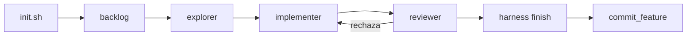

# Grafo de Conocimiento — MeshHarmes

> Lo genera el agente `knowledge` a partir de graphify. Los nodos se
> representan como wikilinks de Obsidian, así que el grafo se navega desde
> aquí igual que cualquier otra nota.

## Mapa del grafo

```
(proyecto: MeshHarmes)
  ├── (rumbo) → [[01_PROYECTO/objetivo|Objetivo]] · [[01_PROYECTO/arquitectura|Arquitectura]]
  ├── (trabajo) → [[01_PROYECTO/roadmap|Roadmap]] · harness/featureslist.json
  ├── (agentes) → [[05_AGENTES/_index|Agentes]]
  │     ├── [[05_AGENTES/HarnessAgent|Harness Agent]]
  │     ├── [[05_AGENTES/PlanAgent|Plan Agent]]
  │     ├── [[05_AGENTES/TestAgent|Test Agent]]
  │     └── ...
  └── (meta) → [[00_META/IA_index|Índice IA]]
```

## Nodos detectados

```dataview
TABLE file.tags as Tags, created as Created
FROM "05_AGENTES"
SORT file.name ASC
```

## Cómo se regenera

```bash
uv run python -m agents run knowledge status      # ¿hay grafo? ¿está al día?
uv run python -m agents run knowledge sync_vault  # reconstruye estas notas
```

## Flujo del arnés


