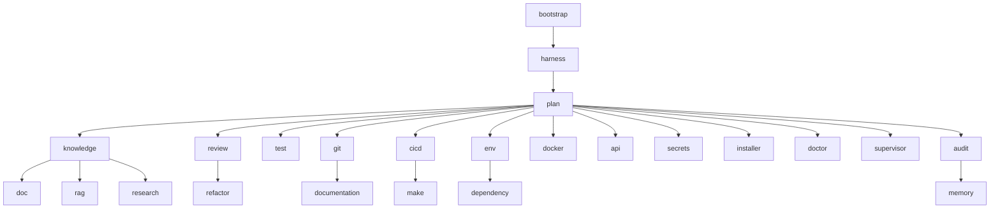

# Directorio de Agentes — MeshHarmes

> Punto de entrada para navegar las fichas de agentes del proyecto. Cada ficha
> detalla rol, capacidades, límites y recursos, extraídos de
> `agents/contracts.py`. Para la versión ejecutable:
> `uv run python -m agents describe <agente>`.

## Arnés y coordinación

| Agente | Rol | Archivo |
|--------|-----|---------|
| [[05_AGENTES/BootstrapAgent\|Bootstrap Agent]] | Arranque en frío: objetivo escrito y backlog sembrado | `agents/agents/bootstrap_agent.py` |
| [[05_AGENTES/HarnessAgent\|Harness Agent]] | Dueño del backlog y el progreso; ejecuta la puerta | `agents/agents/harness_agent.py` |
| [[05_AGENTES/PlanAgent\|Plan Agent]] | Jefe de proyecto: descompone encargos y delega | `agents/agents/plan_agent.py` |
| [[05_AGENTES/SupervisorAgent\|Supervisor Agent]] | Coordina workers en competencia | `agents/agents/supervisor_agent.py` |
| [[05_AGENTES/AuditAgent\|Audit Agent]] | Auditor del equipo | `agents/agents/audit_agent.py` |

## Conocimiento

| Agente | Rol | Archivo |
|--------|-----|---------|
| [[05_AGENTES/KnowledgeAgent\|Knowledge Agent]] | Dueño del grafo de conocimiento y del vault | `agents/agents/knowledge_agent.py` |
| [[05_AGENTES/DocAgent\|Doc Agent]] | Búsqueda unificada: grafo + RAG + vault | `agents/agents/doc_agent.py` |
| [[05_AGENTES/RagAgent\|RAG Agent]] | Índice semántico local (ChromaDB) | `agents/agents/rag_agent.py` |
| [[05_AGENTES/ResearchAgent\|Research Agent]] | Investigador externo (arXiv/OpenAlex) | `agents/agents/research_agent.py` |
| [[05_AGENTES/MemoryAgent\|Memory Agent]] | Memoria proactiva de trayectorias | `agents/agents/memory_agent.py` |

## Código y calidad

| Agente | Rol | Archivo |
|--------|-----|---------|
| [[05_AGENTES/ReviewAgent\|Review Agent]] | Revisor de código (solo lectura) | `agents/agents/review_agent.py` |
| [[05_AGENTES/RefactorAgent\|Refactor Agent]] | Único que modifica código fuente | `agents/agents/refactor_agent.py` |
| [[05_AGENTES/TestAgent\|Test Agent]] | Ejecuta la suite de tests | `agents/agents/test_agent.py` |

## Entrega y entorno

| Agente | Rol | Archivo |
|--------|-----|---------|
| [[05_AGENTES/GitAgent\|Git Agent]] | Único que escribe en git | `agents/agents/git_agent.py` |
| [[05_AGENTES/DocumentationAgent\|Documentation Agent]] | Dueño de la documentación | `agents/agents/documentation_agent.py` |
| [[05_AGENTES/CICDAgent\|CI/CD Agent]] | Dueño de workflows CI/CD | `agents/agents/cicd_agent.py` |
| [[05_AGENTES/MakeAgent\|Make Agent]] | Dueño del Makefile | `agents/agents/make_agent.py` |
| [[05_AGENTES/EnvAgent\|Env Agent]] | Dueño del entorno Python | `agents/agents/env_agent.py` |
| [[05_AGENTES/DependencyAgent\|Dependency Agent]] | Vigilante de dependencias | `agents/agents/dependency_agent.py` |
| [[05_AGENTES/DockerAgent\|Docker Agent]] | Revisor de Docker | `agents/agents/docker_agent.py` |
| [[05_AGENTES/APIAgent\|API Agent]] | Revisor de API FastAPI | `agents/agents/api_agent.py` |
| [[05_AGENTES/SecretsAgent\|Secrets Agent]] | Escáner de secretos | `agents/agents/secrets_agent.py` |
| [[05_AGENTES/InstallerAgent\|Installer Agent]] | Dueño de `agents/external/` | `agents/agents/installer_agent.py` |
| [[05_AGENTES/DoctorAgent\|Doctor Agent]] | Diagnóstico integral | `agents/agents/doctor_agent.py` |
